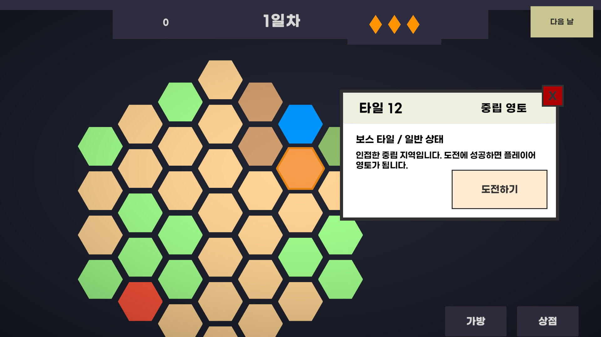
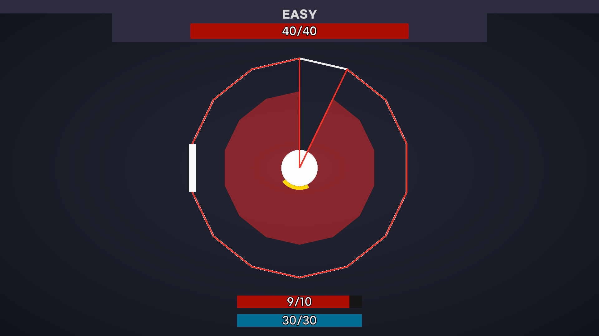

# FACE-OFF

🎮 [게임 플레이하기 (itch.io)](https://fbdfbd.itch.io/face-off)

**FACE-OFF**는 영토 점령과 보스전을 결합한 싱글 플레이 액션/전략 게임입니다.
14각형 타일로 이루어진 지도에서 진출할 지역을 선택하고, 전투에서는 보스 주변을 이동하며 공격을 피해 약점을 공략합니다.

제한된 도전 기회를 확장에 사용할지, 위협받는 영토를 지키는 데 사용할지 결정하세요.
전투에서 패배하더라도 영토 경쟁은 계속됩니다. 어디를 점령하고 어디를 지킬지 판단해 최종 승리를 노리세요.

## 게임 목표

주어진 **10일** 동안 적과 영토를 두고 경쟁합니다. 승리를 향한 방법은 두 가지입니다.

- **영토 경쟁:** 마지막 날 영토 정산에서 적보다 많은 타일을 확보하세요. 영토 수가 같으면 무승부입니다.
- **적 시작지 점령:** 적의 시작지까지 진출해 전투에서 승리하면 즉시 승리합니다.

## 플레이 흐름

1. **진출할 지역 선택** — 내 영토에 인접한 중립 지역이나 적 영토를 살펴보고 다음 목표를 정합니다.
2. **전투 또는 사건 진행** — 보스를 쓰러뜨리거나 사건의 선택지를 골라 지역과 보상을 확보합니다.
3. **보상으로 전투 준비** — 골드로 장비와 소모품을 구매하고, 다음 도전에 맞춰 장비를 조합합니다.
4. **확장과 방어 판단** — 남은 도전 기회로 영토를 넓히거나 적의 점령이 예고된 지역을 지킵니다.
5. **다음 날 진행** — 영토 수입을 받고, 변화한 전선을 바탕으로 다음 행동을 계획합니다.

## 주요 특징

### 한정된 기회로 펼치는 영토 경쟁

하루에 주어지는 기본 도전 기회는 **3회**입니다.
인접한 중립 지역을 확보해 진출 경로를 만들고, 적 영토를 공격해 세력을 넓힐 수 있습니다.

적도 날짜가 지날수록 더 많은 지역으로 세력을 확장합니다.
점령이 예고된 내 영토를 방어할지, 그 기회에 다른 지역을 공략할지 선택해야 합니다.

확보한 영토는 매일 골드 수입으로 이어집니다.
영토를 넓혀 장비를 마련하고, 강화된 전투력으로 다음 지역을 노리세요.

### 보스 주변을 돌며 펼치는 약점 공략

전투에서는 보스를 둘러싼 다각형 전장의 둘레를 따라 이동합니다.
공격이 예고된 구역을 벗어나고, 보스의 약점을 공격할 수 있는 위치를 찾아야 합니다.

연속으로 이어지는 구역 공격과 지뢰 등 보스의 패턴에 맞춰 움직이세요.
중립 지역, 적 영토, 방어전, 적 시작지 등 도전하는 상황에 따라 보스의 난도가 달라집니다.

### 회피와 공격 사이의 자원 관리

공격을 적중시키면 특수 게이지를 회복합니다.
이 게이지는 **반대편으로 가로지르는 이동**과 **특수 공격**에 함께 사용됩니다.

위험한 순간을 벗어날 여유를 남길지, 공격에 투자해 전투를 빠르게 끝낼지 판단하세요.
연속 적중으로 콤보를 쌓는 재미도 더해집니다.

### 코스트 안에서 만드는 나만의 장비 조합

상점에서 구매한 장비는 **총 코스트 10 이내**에서 조합할 수 있습니다.
공격 속도, 이동 속도, 최대 체력, 특수 게이지 소비량 등 자신의 플레이에 맞는 효과를 선택하세요.

- 공격 간격을 줄여 더 자주 공격하기
- 이동 간격을 줄이거나 연속 이동을 활용해 위치 잡기
- 최대 체력을 늘리거나 조건부 체력 회복으로 생존력 높이기
- 특수 게이지 소비량을 줄여 이동과 특수 공격 활용하기

캐릭터 색상을 바꾸는 장비로 외형도 꾸밀 수 있습니다.

### 탐색 중 만나는 사건

일부 지역에서는 보급 상자나 휴식 지점 같은 사건을 만납니다.
선택에 따라 골드나 소모품을 얻거나, 추가 보상을 위한 전투에 도전할 수 있습니다.

## 기본 조작

| 입력 | 행동 |
| --- | --- |
| `A` / `D` 또는 `←` / `→` | 전장 둘레를 따라 양옆으로 이동 |
| 마우스 왼쪽 버튼 또는 `Z` | 일반 공격 |
| `Space` 또는 `X` | 특수 게이지를 소모해 전장 반대편으로 이동 |
| `C` | 특수 게이지를 소모해 특수 공격 |
| 지도에서 타일 클릭 | 지역 정보 확인 및 도전 선택 |

